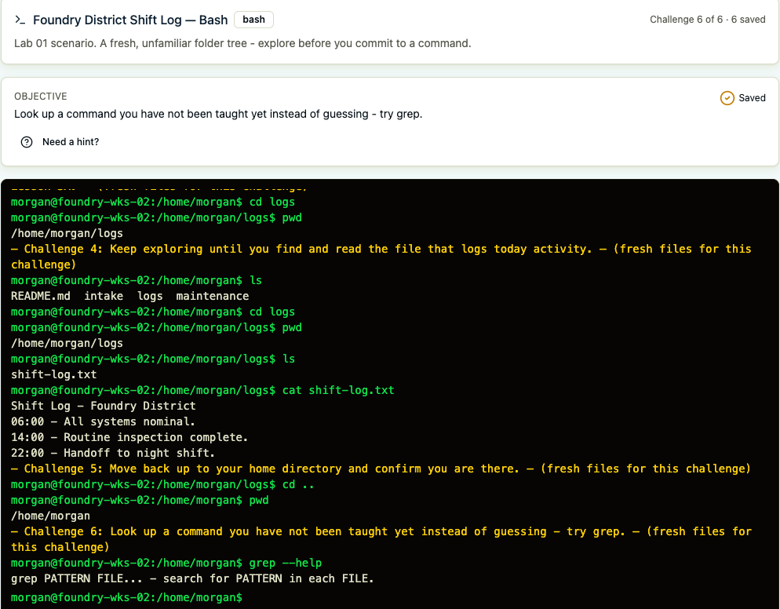

# Week 3 Lab — Navigate Your First File System (CLI Simulator)

**Student Name:** Siri Keyaka

**Date Completed:** 08 October 2026

**Module:** 1 — Digital Infrastructure & CLI | **Week:** 3  
**Submission Path:** `week-03/labs/lab-01-command-line-navigation.md`

---

## Overview

This lab introduces foundational command-line navigation using the CyberFoundations CLI Simulator. The exercise focuses on identifying the current directory, exploring folder structures, navigating between directories, reading file contents, and accessing command documentation.

The activities demonstrate how basic command-line tools support file system navigation and information retrieval, skills applicable to system administration and cybersecurity investigations.

## Lab Environment

| Component | Details |
| --- | --- |
| Environment | CyberFoundations CLI Simulator |
| Shell Used | Bash |
| Exercise | Foundry District Shift Log |
| Focus | File system navigation, file inspection, and command documentation |

---

## Part A — Find Your Way

### Step 1 — Check Your Starting Point

**Matches Challenge 1.** Run the command that tells you where you currently are (`pwd` in bash, `Get-Location` in PowerShell).

Command you ran:

```
pwd
```

Output (your current path):

```
/home/morgan
```

### Step 2 — Look Around

**Matches Challenge 2.** Run the command that lists what's in your current location (`ls` in bash, `dir` or `Get-ChildItem` in PowerShell).

Command you ran:

```
ls
```

Output (files/folders listed):

```
README.md  intake  logs  maintenance
```

### Step 3 — Predict Before You Move

**Do this before you press Next into Challenge 3.** Look at the folder names from Step 2 and guess which one might contain a shift log or notes file. Write your guess down first — you'll check it in Part B.

My guess:

```
I think the logs folder contains the shift log because logs are commonly used to record activities and events.
```

---

## Part B — Move and Peek

### Step 1 — Move Into a Folder

**Matches Challenge 3 (first half).** Challenge 3 starts in your home folder. Use `cd` (bash) or `cd`/`Set-Location` (PowerShell) with a folder name from Part A, Step 2 to move into the folder you guessed.

Command you ran:

```
cd logs
```

### Step 2 — Confirm Your New Location

**Matches Challenge 3 (second half).** Right after moving, run `pwd` or `Get-Location` to confirm exactly where you landed. Challenge 3 is complete only when you move **and then** check.

Command you ran:

```
pwd
```

Output (your new path):

```
/home/morgan/logs 
```

### Step 3 — Look Around Again

**Matches Challenge 4 (searching).** Challenge 4 starts fresh in your home folder again — not in the folder from Challenge 3. Run `pwd`/`Get-Location` to check, then use `cd` and `ls`/`dir` to look inside the folders until you find the file that logs today's activity.

Command you ran:

```
ls
cd logs
pwd
ls
```

Output:

```
README.md  intake  logs  maintenance
/home/morgan/logs
shift-log.txt
```

### Step 4 — Peek Inside the File

**Matches Challenge 4 (reading).** Once you've found the log file, use `cat` (bash) or `type`/`Get-Content` (PowerShell) to read its contents. Was your guess from Part A, Step 3 right?

Command you ran:

```
cat shift-log.txt
```

File contents:

```
Shift Log - Foundry District
06:00 - All systems nominal.
14:00 - Routine inspection complete.
22:00 - Handoff to night shift.
```

### Step 5 — Move Back Up

**Matches Challenge 5.** Challenge 5 starts you inside a folder below home (run `pwd`/`Get-Location` to see where). Your goal is to return to your home folder, `/home/morgan`. Use `cd ..` (in bash, plain `cd` also works), then confirm with `pwd`/`Get-Location` that you are in `/home/morgan`.

Command you ran:

```
cd ..
pwd
```

Output (confirming your new — higher — location):

```
/home/morgan
```

---

## Part C — Ask for Help

### Step 1 — Pick an Unfamiliar Command

**Matches Challenge 6.** The challenge names one command you haven't been taught yet: `grep` in the bash box, or `Get-Acl` in the PowerShell box. Instead of guessing what it does, ask the terminal directly.

### Step 2 — Run the Help Command

In bash, use `grep --help` (or `man grep`). In PowerShell, use `Get-Help Get-Acl`. Read the output, then describe it in your own words.

Command you ran:

```
grep --help
```

What the help text told you the command does, in your own words:

```
The `grep` command searches through files for specific words or patterns. It helps you find information quickly without having to read through every line of a file manually. This can be useful when reviewing logs or looking for specific activity.
```

---

## Analysis Questions

### Analysis Question 1

Look at the path `pwd` (or `Get-Location`) printed in Part A, Step 1. In this simulator, both the bash and PowerShell boxes use Linux-style paths. Explain what makes this path Linux-style, and describe what a Windows-style path would look like instead. Reference at least one specific detail from Lesson 2 (a drive letter, a slash direction, or the presence of a ~) to support your answer.

```
The path `/home/morgan` is Linux-style because it starts with a forward slash (`/`) and uses forward slashes to separate directories. Windows paths typically begin with a drive letter, such as `C:`, and use backslashes, like `C:\Users\Morgan`. Both paths show where a file or folder is located, but they use different formats depending on the operating system.
```

### Analysis Question 2

In Part B, you ran `pwd`/`Get-Location` right after moving with `cd`, more than once. Explain why that "move, then check" habit matters, especially while you're still building confidence with the command line.

```
The "move, then check" habit is important because it helps confirm that I am in the correct directory before running additional commands. Using `pwd` immediately after `cd` prevents confusion, especially when navigating through multiple folders. As a beginner, this habit helps build confidence and reduces the chances of accidentally working in the wrong location.
```

### Analysis Question 3

In Part C, you looked up a command you'd never used before, instead of guessing or skipping it. Explain why this habit — asking the terminal for help instead of memorizing everything in advance — matters for a real career in IT or cybersecurity.

```
Knowing how to use help commands is important because there are too many commands to memorize, especially when starting a career in IT or cybersecurity. Instead of guessing, I can use commands like `--help` to understand what a command does and how to use it correctly. This helps me become more independent, troubleshoot problems, and continue learning as I encounter unfamiliar tools.
```

### Analysis Question 4

Compare this lab to Lesson 1's filing-room analogy (the pile of paper vs. the labeled cabinets). Now that you've actually navigated a file-system tree yourself instead of just reading about one, what — if anything — surprised you or felt different from what you expected?

```
Navigating the file system reminded me of the filing-room analogy because each folder organizes information into a specific location, similar to labeled cabinets. What stood out to me was how much I could do using just a few commands without opening folders manually. It was also interesting to see how the file path changed as I moved between directories, making the folder structure easier to understand.
```
---
## Lab Evidence

The screenshot below documents the Bash commands executed during the Foundry District Shift Log exercise, including directory navigation, file inspection, and command help.



---

*CyberVisionaries Institute · Cyber Foundations · Week 3*
