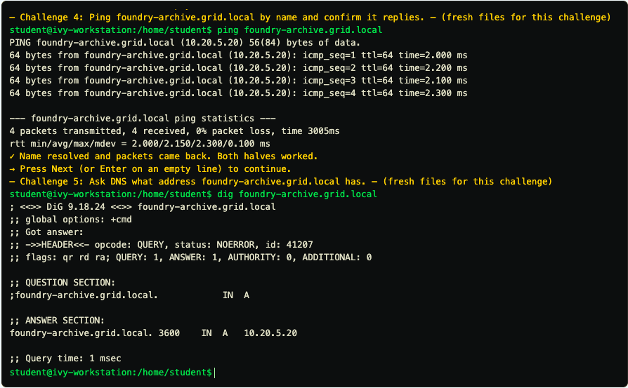
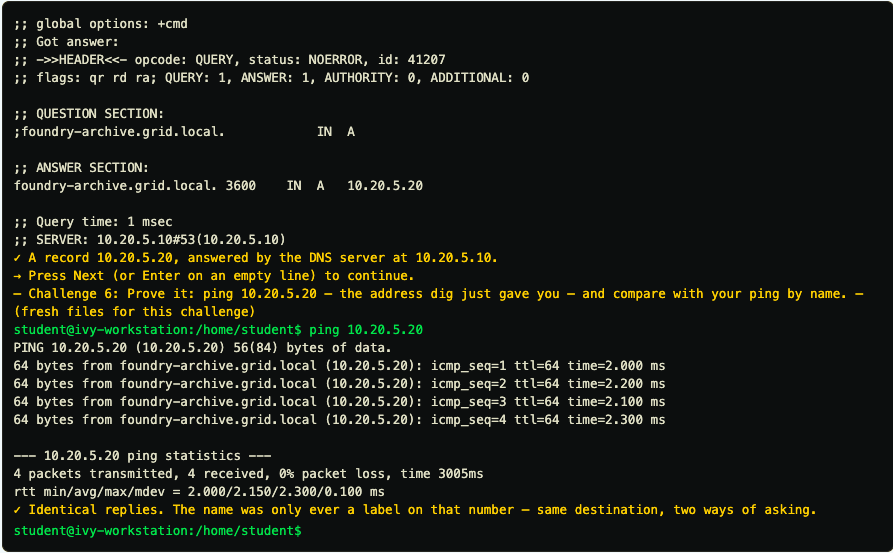
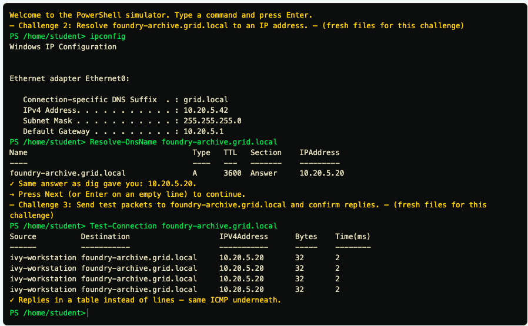

# Week 5 Lab 01 — Finding Your Place on the Grid (CLI Simulator)

**Student Name:** Siri Keyaka


**Module:** 2 — Networking & Cloud Foundations | **Week:** 5  

---

## Overview


This lab focused on network addressing, connectivity testing, and DNS resolution using Bash and PowerShell. I used commands such as `ip addr`, `ip route`, `ping`, and `dig` to identify my workstation's IP address, subnet mask, and default gateway, test connectivity, and resolve a hostname to its IPv4 address.

I also used PowerShell to perform similar network diagnostics in a Windows environment. Comparing the results helped reinforce how DNS resolution and network connectivity work together, and how the same troubleshooting concepts apply across different operating systems.

---

## Part A — Who Am I


### Step 1 — Read Your Own Address Plate

Command ran:

```
ip addr
```

Output (the full `ip addr` result):

```
1: lo: <LOOPBACK,UP,LOWER_UP> mtu 65536 qdisc noqueue state UNKNOWN group default qlen 1000
    link/loopback 00:00:00:00:00:00 brd 00:00:00:00:00:00
    inet 127.0.0.1/8 scope host lo
       valid_lft forever preferred_lft forever
2: eth0: <BROADCAST,MULTICAST,UP,LOWER_UP> mtu 1500 qdisc fq_codel state UP group default qlen 1000
    link/ether 02:1a:7c:44:0b:5e brd ff:ff:ff:ff:ff:ff
    inet 10.20.5.42/24 brd 10.20.5.255 scope global eth0
       valid_lft forever preferred_lft forever
```

### Step 2 — Pull Out Your IPv4 Address


IPv4 address:

```
10.20.5.42
```

### Step 3 — Translate the Slash Into a Subnet Mask

The prefix length and the subnet mask it means:

```
/24 = 255.255.255.0
```

### Step 4 — Find the Door Out

```
ip route
```


The full `ip route` output:

```
default via 10.20.5.1 dev eth0
10.20.5.0/24 dev eth0 proto kernel scope link src 10.20.5.42
```

Default gateway — the address on the `default` line:

```
10.20.5.1
```

### Step 5 — Say It in a Sentence

```
My workstation's IP address is 10.20.5.42, and devices on the 10.20.5.0/24 network are my local neighbors. Any traffic going outside that network is sent through the default gateway at 10.20.5.1.
```

---

## Part B — Can I Get Out

### Step 1 — Ping Your Gateway

Command ran:

```
ping 10.20.5.1
```

Output (the full ping result, including the summary line):

```
PING 10.20.5.1 (10.20.5.1) 56(84) bytes of data.
64 bytes from grid-gateway (10.20.5.1): icmp_seq=1 ttl=64 time=1.000 ms
64 bytes from grid-gateway (10.20.5.1): icmp_seq=2 ttl=64 time=1.200 ms
64 bytes from grid-gateway (10.20.5.1): icmp_seq=3 ttl=64 time=1.100 ms
64 bytes from grid-gateway (10.20.5.1): icmp_seq=4 ttl=64 time=1.300 ms

--- 10.20.5.1 ping statistics ---
4 packets transmitted, 4 received, 0% packet loss, time 3005ms
rtt min/avg/max/mdev = 1.000/1.150/1.300/0.100 ms
```

### Step 2 — Read the Result

How many packets were sent, how many came back, and the typical round-trip time:

```
4 packets were sent and all 4 were received, resulting in 0% packet loss. The average round-trip latency was 1.150 ms.
```

### Step 3 — Ping a Machine by Name

Command ran:

```
ping foundry-archive.grid.local
```

Output (the full ping result):

```
PING foundry-archive.grid.local (10.20.5.20) 56(84) bytes of data.
64 bytes from foundry-archive.grid.local (10.20.5.20): icmp_seq=1 ttl=64 time=2.000 ms
64 bytes from foundry-archive.grid.local (10.20.5.20): icmp_seq=2 ttl=64 time=2.200 ms
64 bytes from foundry-archive.grid.local (10.20.5.20): icmp_seq=3 ttl=64 time=2.100 ms
64 bytes from foundry-archive.grid.local (10.20.5.20): icmp_seq=4 ttl=64 time=2.300 ms

--- foundry-archive.grid.local ping statistics ---
4 packets transmitted, 4 received, 0% packet loss, time 3005ms
rtt min/avg/max/mdev = 2.000/2.150/2.300/0.100 ms
```

### Step 4 — Note What Ping Quietly Did For You

```
The hostname foundry-archive.grid.local resolved to 10.20.5.20. All four packets were received with 0% packet loss and an average round-trip time of 2.150 ms. This confirms that the archive server is reachable by its hostname.
```

---

## Part C — Name to Number

### Step 1 — Ask the Directory Board Directly

Command ran:

```
dig foundry-archive.grid.local
```

Output (the full `dig` result):

```
; <<>> DiG 9.18.24 <<>> foundry-archive.grid.local
;; global options: +cmd
;; Got answer:
;; ->>HEADER<<- opcode: QUERY, status: NOERROR, id: 41207
;; flags: qr rd ra; QUERY: 1, ANSWER: 1, AUTHORITY: 0, ADDITIONAL: 0

;; QUESTION SECTION:
;foundry-archive.grid.local.             IN A

;; ANSWER SECTION:
foundry-archive.grid.local.  3600 IN A 10.20.5.20

;; Query time: 1 msec
;; SERVER: 10.20.5.10#53(10.20.5.10)
```

### Step 2 — Record the A Record


```
Hostname: foundry-archive.grid.local
IPv4 address (A record): 10.20.5.20
```

### Step 3 — Record Who Answered


The answering server's address and the port number:

```
DNS server: 10.20.5.10
Port: 53
```

### Step 4 — Prove It Yourself

Command ran:

```
ping 10.20.5.20
```

Output (the full ping result):

```
PING 10.20.5.20 (10.20.5.20) 56(84) bytes of data.
64 bytes from foundry-archive.grid.local (10.20.5.20): icmp_seq=1 ttl=64 time=2.000 ms
64 bytes from foundry-archive.grid.local (10.20.5.20): icmp_seq=2 ttl=64 time=2.200 ms
64 bytes from foundry-archive.grid.local (10.20.5.20): icmp_seq=3 ttl=64 time=2.100 ms
64 bytes from foundry-archive.grid.local (10.20.5.20): icmp_seq=4 ttl=64 time=2.300 ms

--- 10.20.5.20 ping statistics ---
4 packets transmitted, 4 received, 0% packet loss, time 3005ms
rtt min/avg/max/mdev = 2.000/2.150/2.300/0.100 ms
```

### Step 5 — The Aha: The Name and the Number Are the Same Place

Explanation:

```
Both pings reached the same server at 10.20.5.20 and returned identical results, confirming that the hostname and IP address point to the same destination. The dig command showed how DNS translates foundry-archive.grid.local into its IP address using an A record. It also showed that the DNS server at 10.20.5.10 answered the request on port 53.
```

---

## Part D — The Windows Side


### Step 1 — Your Address, Windows Edition

Command ran:

```
ipconfig
```

Output (the full `ipconfig` result):

```
Windows IP Configuration

Ethernet adapter Ethernet0:

   Connection-specific DNS Suffix  . : grid.local
   IPv4 Address. . . . . . . . . . . : 10.20.5.42
   Subnet Mask . . . . . . . . . . . : 255.255.255.0
   Default Gateway . . . . . . . . . : 10.20.5.1
```

### Step 2 — Compare the Two Views

```
PowerShell's `ipconfig` displays the IPv4 address, subnet mask, and default gateway together, while Bash's `ip addr` shows the network interfaces and uses prefix notation for the subnet mask. Both commands showed the same IPv4 address, 10.20.5.42.
```

### Step 3 — Look Up the Name, Windows Edition

Command ran:

```
Resolve-DnsName foundry-archive.grid.local
```

Output (the full result):

```
Name                                     Type   TTL   Section    IPAddress
----                                     ----   ---   -------    ---------
foundry-archive.grid.local               A      3600  Answer     10.20.5.20
```

The IP address it returned:

```
10.20.5.20
```

### Step 4 — Test Reachability, Windows Edition

Command ran:

```
Test-Connection foundry-archive.grid.local
```

Output (the full result):

```
Source          Destination                    IPV4Address      Bytes    Time(ms)
------          -----------                    -----------      -----    --------
ivy-workstation foundry-archive.grid.local     10.20.5.20       32       2
ivy-workstation foundry-archive.grid.local     10.20.5.20       32       2
ivy-workstation foundry-archive.grid.local     10.20.5.20       32       2
ivy-workstation foundry-archive.grid.local     10.20.5.20       32       2
```

### Step 5 — Build Your Own Translation Table

```
1. Show my address
   Bash: ip addr
   PowerShell: ipconfig

2. Test reachability
   Bash: ping
   PowerShell: Test-Connection

3. Look up a name
   Bash: dig
   PowerShell: Resolve-DnsName
```

---

## Analysis Questions

**Analysis Question 1.** In Part C you proved that pinging `foundry-archive.grid.local` and pinging `10.20.5.20` reach the same machine. If the number works perfectly well on its own, why does The Grid bother having names at all? Give at least two distinct reasons, and think beyond "names are easier to remember." *(Minimum 3 sentences.)*

```
DNS names make it easier to manage network resources because a server's IP address can change without users needing to learn a new address. Administrators can update the DNS record so the same hostname continues pointing to the correct server. DNS also helps organizations manage multiple servers and services, including directing traffic to different servers for load balancing or availability.
```

**Analysis Question 2.** Part A gave you three numbers: your address, your subnet mask, and your default gateway. Explain what the subnet mask lets your machine decide, and what your machine does with a packet when the answer to that decision is "not a neighbour." *(Minimum 3 sentences.)*

```
The subnet mask helps my workstation determine whether another device is on the same local network or a different network. My subnet mask is 255.255.255.0 (/24), which means devices within the 10.20.5.0/24 subnet are considered local neighbors. If a packet is going to an address outside that subnet, my workstation sends it to the default gateway at 10.20.5.1, which forwards it toward the destination.
```

**Analysis Question 3.** You asked the same three questions twice — once in bash, once in PowerShell — and got the same three answers. Why is it worth learning both sets of words rather than picking a favourite and ignoring the other? Answer in terms of the job, not the exam. *(Minimum 2 sentences.)*

```
It's important to understand both Bash and PowerShell because different systems and work environments use different operating systems. In IT and cybersecurity, I may need to troubleshoot Linux and Windows machines, so knowing both sets of commands allows me to investigate network issues and perform diagnostics without being limited to one environment.
```

---

### Lab 01 Screenshots

**Bash: Ping by hostname and DNS lookup**



**Bash: DNS results and direct IP ping**



**PowerShell: Network configuration and connectivity**




---

*CyberVisionaries Institute · Cyber Foundations · Tier I*
