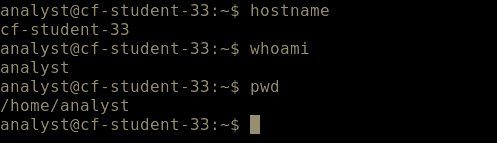

# Week 6 Lab 01 — Claiming Your Room in Cloud Heights

**Module:** 2 — Networking & Cloud Foundations  
**Environment:** Microsoft Azure | Ubuntu 22.04 | Azure Bastion  
**Focus:** Cloud VM Access, Linux CLI Verification, Golden Images & Recovery

---

## Overview

This lab focused on accessing and verifying a provisioned Ubuntu virtual machine in the Cloud Heights training environment. Using Azure Bastion, I established a browser-based terminal session and verified the machine hostname, active user account, and working directory through Linux commands.

The exercise also covered standardized VM deployment, golden images, snapshots, backups, and the importance of controlled access to cloud resources.

## Lab Environment

| Component | Details |
|---|---|
| Cloud Platform | Microsoft Azure |
| Operating System | Ubuntu 22.04 |
| Remote Access | Azure Bastion |
| User Account | `analyst` |
| Command-Line Interface | Bash |
| Commands Used | `hostname`, `whoami`, `pwd` |

## Part A — VM Access and Environment Verification

### 1. VM Initialization

Accessed the Cloud Heights environment through the CyberFoundations Lab Portal and confirmed that the assigned VM was running before opening the remote session.

**VM Status:** Running

### 2. Remote Session

Established a browser-based Ubuntu terminal session through Azure Bastion using the assigned training account.

The session displayed the CyberFoundations training environment welcome message and an interactive Linux command prompt.

### 3. Hostname Verification

**Command:**
```bash
hostname
```

**Output:**
```text
cf-student-33
```

The hostname identified the VM connected to the active session.

### 4. User Identity Verification

**Command:**
```bash
whoami
```

**Output:**
```text
analyst
```

The output confirmed that the session was running under the assigned `analyst` account rather than the root account.

### 5. Working Directory Verification

**Command:**
```bash
pwd
```

**Output:**
```text
/home/analyst
```

The output confirmed that the current working directory was the assigned user's home directory.

## Part B — Verification Findings

The three commands provided a baseline for confirming the active Linux environment:

| Command | Verification | Result |
|---|---|---|
| `hostname` | Identifies the connected machine | `cf-student-33` |
| `whoami` | Identifies the active user account | `analyst` |
| `pwd` | Identifies the current working directory | `/home/analyst` |

Together, these results verified the connected VM's hostname, active user identity, and filesystem location.

### Screenshot Evidence

The screenshot captures the terminal prompt, all three commands, and their corresponding outputs.



**Evidence file:** `assets/screenshots/week-06/bastion-session.png`

## Part C — Cloud Provisioning and System Recovery

### 1. Standardized Golden Images

A golden image is a standardized, preconfigured system image used to deploy multiple machines with consistent baseline settings.

Organizations use golden images to streamline provisioning, reduce configuration errors, and maintain consistency across environments. They also support faster recovery by allowing systems to be rebuilt from a known-good configuration.

### 2. Standardized Deployment and Individual Environments

Each Cloud Heights VM begins with the same operating system, baseline configuration, and installed tools.

As users work within their assigned environments, files, command histories, and configuration changes become specific to each VM. This allows organizations to maintain standardized deployments while supporting separate working environments.

## Technical Analysis

### 1. Why Restoring a Golden Image Matters

Restoring a standardized image allows an organization to recover when a system becomes corrupted or its configuration is no longer reliable.

For example, if an incorrect configuration change causes a VM to malfunction, rebuilding it from a known-good image may be faster and safer than troubleshooting every issue individually.

This reduces downtime and helps restore a consistent operating environment.

### 2. Snapshots vs. Backups

A snapshot captures a system's state at a specific point in time, allowing changes to be rolled back.

Snapshots commonly depend on the original VM or its underlying storage, making them less suitable for protection against complete storage loss.

A separate backup stores recoverable data independently and provides stronger protection against deletion, corruption, or infrastructure failure.

### 3. Cloud Access Provisioning and Least Privilege

Organizations typically provision cloud resources centrally and grant employees access based on their responsibilities.

This approach supports least-privilege access, consistent security configurations, resource accountability, and cost management.

## Key Takeaways

- Established remote access to an Azure-hosted Ubuntu VM through Azure Bastion.
- Used Linux CLI commands to verify the connected machine, active user, and working directory.
- Demonstrated the importance of validating the environment before performing administrative or investigative tasks.
- Explained how golden images support standardized cloud deployments and system recovery.
- Distinguished VM snapshots from independent backups.
- Reinforced the importance of centrally managed cloud resources and least-privilege access.

---


*CyberVisionaries Institute · Cyber Foundations · Tier I*
