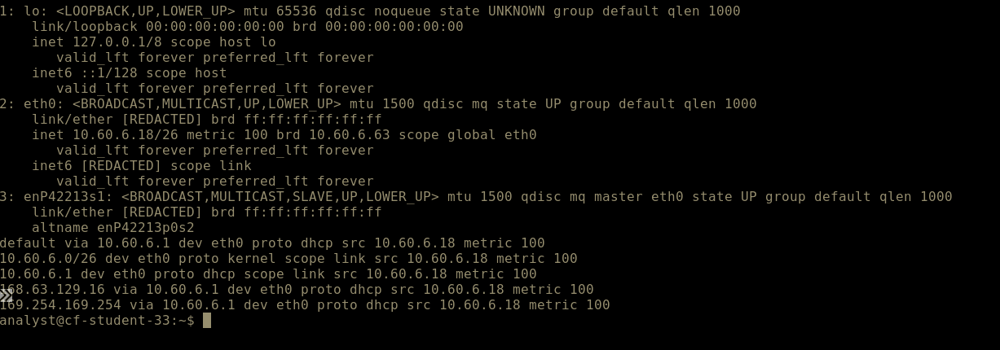
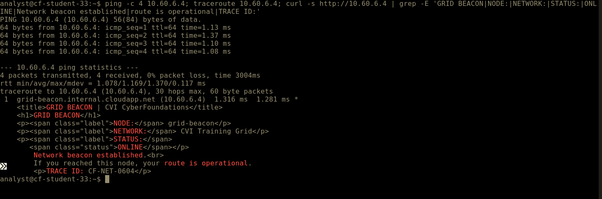

# Week 6 Lab 03 — The Grid, For Real

**Student Name:** Siri Keyaka

**Date Completed:**

**Module:** 2 — Networking & Cloud Foundations | **Week:** 6  
**Submission Path:** `week-06/labs/lab-03-the-grid-for-real.md`

---

> ### 🔒 Cloud Heights Security Rule
> Your Bastion link and Cloud Heights password are **private access credentials**. Never paste either into a worksheet, screenshot, GitHub repository, Circle post, or chat message. When taking screenshots, crop out the browser address bar and all login information.

---

## Overview

In Week 5 you ran `ip addr`, `ip route`, `ping`, and `traceroute` in a simulator that always behaved. Today you run the same toolkit against real cloud infrastructure that does **not** always behave the way the textbook implies — and you learn to tell "broken" apart from "normal."

This is an **independent** lab. It tells you what to accomplish; you choose the commands. Expect about 40 minutes.

---

## Lab Environment / Pre-Lab Check

| Component | Details |
|---|---|
| Environment | Cloud Heights — live Ubuntu 22.04 VM, reached through Azure Bastion |
| Commands used | `ip addr`, `ip route`, `ping`, `traceroute`, `curl` |
| Known-good target | **Grid Beacon — `10.60.6.4`** |
| Prerequisite | Week 6 Labs 01–02 |

---

## Part A — Where You Actually Are

### Step 1 — Read Your Own Address

Run the command that lists your interfaces and addresses.

Command and output:

```
$ ip addr

1: lo: <LOOPBACK,UP,LOWER_UP> mtu 65536 qdisc noqueue state UNKNOWN group default qlen 1000
    link/loopback 00:00:00:00:00:00 brd 00:00:00:00:00:00
    inet 127.0.0.1/8 scope host lo
       valid_lft forever preferred_lft forever
    inet6 ::1/128 scope host
       valid_lft forever preferred_lft forever

2: eth0: <BROADCAST,MULTICAST,UP,LOWER_UP> mtu 1500 qdisc mq state UP group default qlen 1000
    link/ether [MAC address redacted]
    inet 10.60.6.18/26 metric 100 brd 10.60.6.63 scope global eth0
       valid_lft forever preferred_lft forever
    inet6 [link-local IPv6 address redacted] scope link
       valid_lft forever preferred_lft forever

3: enP42213s1: <BROADCAST,MULTICAST,SLAVE,UP,LOWER_UP> mtu 1500 qdisc mq master eth0 state UP group default qlen 1000
    link/ether [MAC address redacted]
    altname enP42213p0s2
```

Your private IPv4 address and prefix length:

```
10.60.6.18/26
```

### Step 2 — Read Your Route

Run the command that shows the routing table.

Command and output:

```
$ ip route

default via 10.60.6.1 dev eth0 proto dhcp src 10.60.6.18 metric 100
10.60.6.0/26 dev eth0 proto kernel scope link src 10.60.6.18 metric 100
10.60.6.1 dev eth0 proto dhcp scope link src 10.60.6.18 metric 100
168.63.129.16 via 10.60.6.1 dev eth0 proto dhcp src 10.60.6.18 metric 100
169.254.169.254 via 10.60.6.1 dev eth0 proto dhcp src 10.60.6.18 metric 100
```

Your default gateway:

```
10.60.6.1
```

### Step 3 — Compare to Week 5

Compare this live Ubuntu output to what the CLI Simulator produced in Week 5. What looks the same, what looks different, and what surprised you:

```
Both the Week 5 CLI Simulator and the live Ubuntu VM displayed network interfaces, IP addresses, and routing information. However, the live VM showed additional details, including interface states, MAC addresses, IPv6 addresses, routing metrics, and Azure-specific routes. I was surprised by how much more detailed the real routing table was compared to the simulator. This helped me understand how the same networking commands apply in a real cloud environment.
```

---

## Part B — The Gateway That Does Not Answer

### Step 1 — Ping the Gateway

Ping the default gateway address you recorded. Let it run a few seconds, then stop it.

Command and output:

```
$ ping -c 4 10.60.6.1

PING 10.60.6.1 (10.60.6.1) 56(84) bytes of data.

--- 10.60.6.1 ping statistics ---
4 packets transmitted, 0 received, 100% packet loss, time 3099ms
```

### Step 2 — Interpret It Correctly

You almost certainly got **no replies**. In Azure, the platform gateway commonly does not answer ICMP. This is **expected platform behaviour** and by itself proves nothing about whether your machine or network is broken.

Explain why "the gateway did not answer ping" is weak evidence:

```
The gateway did not respond to ping, but this does not necessarily indicate a network failure. Azure gateways commonly do not respond to ICMP requests. I would check the routing table and test a known-good destination before concluding that the network is broken.
```

---

## Part C — The Known-Good Target

The **Grid Beacon** at `10.60.6.4` is a machine that is known to be up and known to answer. When your first probe fails, you test against something known-good before you conclude anything.

### Step 1 — Ping the Beacon

```
ping 10.60.6.4
```
Output:

```
$ ping -c 4 10.60.6.4

PING 10.60.6.4 (10.60.6.4) 56(84) bytes of data.
64 bytes from 10.60.6.4: icmp_seq=1 ttl=64 time=5.38 ms
64 bytes from 10.60.6.4: icmp_seq=2 ttl=64 time=1.28 ms
64 bytes from 10.60.6.4: icmp_seq=3 ttl=64 time=1.17 ms
64 bytes from 10.60.6.4: icmp_seq=4 ttl=64 time=1.14 ms

--- 10.60.6.4 ping statistics ---
4 packets transmitted, 4 received, 0% packet loss, time 3004ms
rtt min/avg/max/mdev = 1.138/2.241/5.384/1.814 ms
```

### Step 2 — Trace the Path

```
traceroute 10.60.6.4
```
Output:

```
$ traceroute 10.60.6.4

traceroute to 10.60.6.4 (10.60.6.4), 30 hops max, 60 byte packets
 1  grid-beacon.internal.cloudapp.net (10.60.6.4)  1.515 ms  1.476 ms  1.462 ms
```

### Step 3 — Ask the Application

```
curl http://10.60.6.4
```
Output:

```
$ curl http://10.60.6.4

<title>GRID BEACON | CVI CyberFoundations</title>

<h1>GRID BEACON</h1>

NODE: grid-beacon
NETWORK: CVI Training Grid
STATUS: ONLINE

Network beacon established.
If you reached this node, your route is operational.

INVESTIGATION CHECKPOINT

Observe the path that brought you here.
The destination is only part of the story.

TRACE ID: CF-NET-0604
```

> ### ⚠️ Grid Beacon not responding?
> The Grid Beacon is shared course infrastructure and should normally be available. First, confirm your Cloud Heights VM shows **Running** and that you completed the preceding network checks. Then retry the command once after a minute or two.
>
> If the Grid Beacon still does not respond, **stop this part of the lab and contact your instructor.** Record that the shared service was unavailable; do not treat the result as evidence that your VM or your work is incorrect.
>
> Do not change networking, NSGs, firewall rules, routes, DNS, or any Azure settings to try to reach the beacon.
>
> *Instructor note: a confirmed Grid Beacon outage is an environment issue, not a student error. Affected students may complete this portion of Lab 03 after the service is restored, with no penalty.*

### Step 4 — Record the Application Evidence

The beacon returns a banner and a trace ID. Record exactly what you received:

```
GRID BEACON
NODE: grid-beacon
NETWORK: CVI Training Grid
STATUS: ONLINE
Network beacon established.
If you reached this node, your route is operational.

Trace ID: CF-NET-0604
```

Explain the difference between what the `ping` proved and what the `curl` proved:

```
Ping tests whether a destination responds to ICMP requests. Curl tests whether an application responds to an HTTP request. The successful curl response confirmed that the Grid Beacon's web service was running, not just that the host was reachable.

```

### Step 5 — Capture Your Evidence

Two screenshots, both cropped to the terminal only:

**Required filename:** `vm-toolkit-live.png` — your `ip addr` and `ip route` output



**Required filename:** `beacon-reply.png` — your beacon ping/traceroute/curl evidence



---

## Part D — Rewrite the Ladder Rule

Week 5 taught the Ladder Rule: test the near thing before the far thing. Real infrastructure adds a wrinkle — a silent rung is not automatically a broken rung.

Rewrite the Ladder Rule in your own words so that it survives real cloud infrastructure. Your version must include both **route/path evidence** and **a known-good target**:

```
Start troubleshooting with the closest network components before testing farther destinations. A failed ping does not always mean a connection is broken, especially in cloud environments. Check routing information and test a known-good target to confirm whether network communication is working.
```

---

## Analysis Questions

**Analysis Question 1.** Your ping to the gateway failed and your ping to the beacon succeeded. What does that pair of results, taken together, prove about your machine's networking? *(Minimum 3 sentences.)*

```
The failed gateway ping does not mean my network is broken. The successful beacon ping confirms that my VM can communicate with another device on the network. Together, these results show that a gateway can ignore ICMP requests while network connectivity still works.
```

**Analysis Question 2.** Why is `traceroute` useful even when `ping` already answered? What extra thing does it show you? *(Minimum 2 sentences.)*

```
Ping confirms whether a destination responds, while traceroute shows the path packets take to reach it. Traceroute also identifies responding hops and their response times, helping locate potential network issues.
```

**Analysis Question 3.** A service is unreachable and ping to it succeeds. Where would you look next, and why is "the network is fine" an incomplete answer? *(Minimum 3 sentences.)*

```
I would check whether the application is running and listening on the correct port. I would also investigate firewall rules, service configurations, and application logs. A successful ping only confirms ICMP connectivity, not that the application or its required port is accessible.
```

**Analysis Question 4.** Something already controls what is allowed to reach your machine in Cloud Heights. If you could decide those rules, what would you want to allow, what would you want to block, and who in an organization should get to make that decision? *(Minimum 3 sentences.)*

```
I would allow only necessary traffic from authorized users and trusted systems. I would block unnecessary ports, unauthorized connections, and suspicious traffic to reduce security risks. Security and network administrators should establish these rules with approval from system owners and organizational leadership.
```

---

## Submission Checklist

- [x] `ip addr` output recorded and own private IP/prefix identified (Part A)

- [x] `ip route` output recorded and default gateway identified (Part A)

- [x] Live output compared to the Week 5 simulator (Part A, Step 3)

- [x] Gateway pinged and the silent result interpreted correctly (Part B)

- [x] Beacon `ping`, `traceroute`, and `curl` all run and recorded (Part C)

- [x] Beacon banner and TRACE ID recorded (Part C, Step 4)

- [x] `vm-toolkit-live.png` and `beacon-reply.png` captured, cropped, uploaded to `assets/screenshots/week-06/` (Part C, Step 5)

- [x] Ladder Rule rewritten with route evidence + known-good target (Part D)

- [x] All four Analysis Questions answered (minimum sentence counts met)

- [x] This file is committed to your portfolio repo at `week-06/labs/lab-03-the-grid-for-real.md`

---

## GitHub Commit Subsection

1. Open **Week 6 → Lab 03: The Grid, For Real** in the Lab Portal.
2. Fill in the worksheet fields and upload both screenshots to `assets/screenshots/week-06/`.
3. Click **Submit to GitHub** — the Portal commits to `week-06/labs/lab-03-the-grid-for-real.md`.

---

*CyberVisionaries Institute · Cyber Foundations · Tier I*
