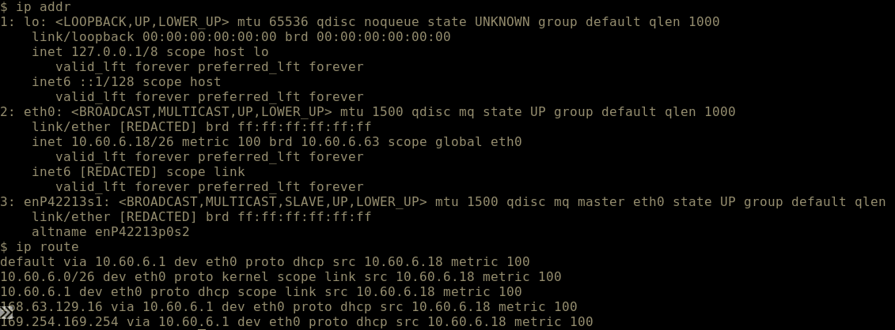

# Week 6 Lab 04 — Reading the Blueprints

**Student Name:** Siri Keyaka

**Date Completed:**

**Module:** 2 — Networking & Cloud Foundations | **Week:** 6  
**Submission Path:** `week-06/labs/lab-04-reading-the-blueprints.md`

---

> ### 🔒 Cloud Heights Security Rule
> Your Bastion link and Cloud Heights password are **private access credentials**. Never paste either into a worksheet, screenshot, GitHub repository, Circle post, or chat message. When taking screenshots, crop out the browser address bar and all login information.

---

## Overview

**This is a SHORT lab — 15 to 20 minutes.** It is deliberately small. You already have the commands; this lab is about matching a drawing to reality.

The **Cloud Heights Network Blueprint** is displayed at the top of this lab page in the portal. Everything you write about the network's architecture comes from that blueprint or from your own machine — never from a guess.

---

## Lab Environment / Pre-Lab Check

| Component | Details |
|---|---|
| Environment | Cloud Heights — live Ubuntu 22.04 VM, reached through Azure Bastion |
| Source of truth | The Cloud Heights Network Blueprint shown at the top of this lab page |
| Commands used | `ip addr`, `ip route` |
| Known value | Student subnet: **`10.60.6.0/26`** |

---

## Part A — Read the Drawing

### Step 1 — Record the Architecture Values

From the blueprint at the top of this page, record each value **exactly as drawn**. If a value is not shown on the blueprint, write "not shown on blueprint" — do not guess.

| Item | Value from the blueprint |
| --- | --- |
| VNet name | vnet-cf-labs |
| VNet address space | 10.60.6.0/24 |
| Student subnet range | 10.60.6.0/26 |

---

## Part B — Verify Against Your Own Machine

### Step 1 — Confirm Your Address Lives in the Subnet

Run `ip addr` and find your private IPv4 address.

Command and output:

```
$ ip addr

1: lo: <LOOPBACK,UP,LOWER_UP> mtu 65536
    inet 127.0.0.1/8 scope host lo
    inet6 ::1/128 scope host

2: eth0: <BROADCAST,MULTICAST,UP,LOWER_UP> mtu 1500
    link/ether [REDACTED]
    inet 10.60.6.18/26 metric 100 brd 10.60.6.63 scope global eth0
    inet6 [REDACTED] scope link

3: enP42213s1: <BROADCAST,MULTICAST,SLAVE,UP,LOWER_UP>
    link/ether [REDACTED]
```

Your private IP:

```
10.60.6.18
```

Explain how you know your address falls inside `10.60.6.0/26` — what range does that prefix actually cover:

```
The 10.60.6.0/26 subnet covers addresses from 10.60.6.0 through 10.60.6.63, with usable host addresses from 10.60.6.1 to 10.60.6.62. My VM's address, 10.60.6.18, falls within that range.
```

### Step 2 — Confirm Route Behaviour

Run `ip route`.

Command and output:

```
$ ip route

default via 10.60.6.1 dev eth0 proto dhcp src 10.60.6.18 metric 100
10.60.6.0/26 dev eth0 proto kernel scope link src 10.60.6.18 metric 100
10.60.6.1 dev eth0 proto dhcp scope link src 10.60.6.18 metric 100
168.63.129.16 via 10.60.6.1 dev eth0 proto dhcp src 10.60.6.18 metric 100
169.254.169.254 via 10.60.6.1 dev eth0 proto dhcp src 10.60.6.18 metric 100
```

What the default route tells you about traffic that is not destined for your own subnet:

```
Traffic destined outside my local subnet is forwarded through the default gateway, 10.60.6.1, using the eth0 interface.
```

### Step 3 — Capture Your Evidence

**Required filename:** `blueprint-verified.png`

This must be **your own `ip addr` and `ip route` output** — not a re-screenshot of the blueprint. Crop out the address bar and any login information.



---

## Part C — How Traffic Actually Moves

### Step 1 — No Public IP

Your VM has a private address and **no public IP**. Explain what that means for who can reach it directly from the internet:

```
My VM has a private IP address that cannot be directly reached from the public internet. External users cannot connect to it directly without an approved access method, such as Azure Bastion.
```

### Step 2 — Outbound vs. Inbound

Outbound internet traffic from your VM leaves through address **translation (NAT)**. Inbound access for you arrives through **Azure Bastion**, not through a public address on the VM.

Explain both directions in your own words:

```
When my VM accesses the internet, NAT translates its private address to an outbound public address. For inbound access, I connect through Azure Bastion instead of using a public IP assigned to the VM. This allows controlled remote access while keeping the VM from being directly exposed to the internet.
```

### Step 3 — The Guard Post You Do Not Touch Yet

Each student machine sits behind its own **network security group** — a per-student guard post that decides what traffic is allowed in.

**In Week 6 you do not configure it.** Week 7 is when you take control of those rules.

Write one sentence naming what the guard post does and one sentence stating what you are *not* doing with it this week:

```
The per-student network security group controls which inbound traffic is allowed to reach my VM. I am not configuring or modifying those security rules during Week 6.
```

---

## Analysis Questions

**Analysis Question 1.** Why would an organization put every student machine in one small subnet instead of giving each machine a public address? *(Minimum 3 sentences.)*

```
Keeping student machines in a private subnet reduces their direct exposure to the internet. It also makes network management and access control easier. Students can access their machines through Azure Bastion without requiring individual public IP addresses.
```

**Analysis Question 2.** Segmentation means separating a network into parts that cannot freely reach each other. Give one concrete benefit of segmentation during a security incident. *(Minimum 3 sentences.)*

```
Segmentation helps contain security threats within a limited network area. If one machine becomes compromised, network restrictions can prevent an attacker from easily reaching other systems. This reduces the potential impact of an incident and gives security teams more time to respond.
```

**Analysis Question 3.** A diagram and a live machine disagree about an address range. Which do you trust, what do you do next, and why? *(Minimum 2 sentences.)*

```
I would use the live machine's configuration to confirm its current address while checking whether the blueprint is outdated or incorrect. I would report the discrepancy to the network administrator because both the documented design and actual configuration need to be verified.
```

---

## Submission Checklist

- [x] VNet name, address space, and subnet range recorded from the blueprint (Part A)

- [x] `ip addr` run and own private IP confirmed inside `10.60.6.0/26` (Part B, Step 1)

- [x] `ip route` run and default route behaviour explained (Part B, Step 2)

- [x] `blueprint-verified.png` captured from your own terminal, cropped, uploaded to `assets/screenshots/week-06/` (Part B, Step 3)

- [x] Private address / NAT / Bastion explained (Part C, Steps 1–2)

- [x] Per-student guard post identified — and explicitly not configured this week (Part C, Step 3)

- [x] All three Analysis Questions answered (minimum sentence counts met)

- [x] This file is committed to your portfolio repo at `week-06/labs/lab-04-reading-the-blueprints.md`

---

## GitHub Commit Subsection

1. Open **Week 6 → Lab 04: Reading the Blueprints** in the Lab Portal.
2. Fill in the worksheet fields and upload `blueprint-verified.png` to `assets/screenshots/week-06/`.
3. Click **Submit to GitHub** — the Portal commits to `week-06/labs/lab-04-reading-the-blueprints.md`.

---

*CyberVisionaries Institute · Cyber Foundations · Tier I*
