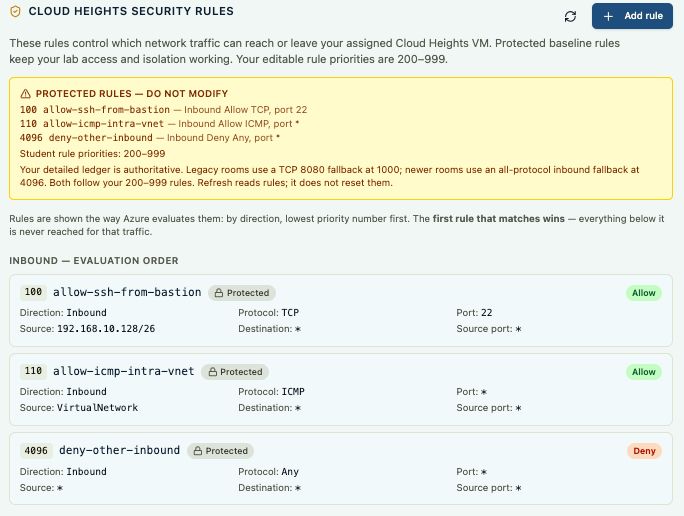

# Week 7 Lab 01 — Meet the Guard

**Student Name:** Siri Keyaka

**Date Completed:**

**Module:** 2 — Networking & Cloud Foundations | **Week:** 7  
**Submission Path:** `week-07/labs/lab-01-meet-the-guard.md`

> ## Cloud Heights Protected-Rules Safety Rule
> Your room uses one of two protected baselines. Check your own **INBOUND — EVALUATION ORDER** list to see which one you have:
>
> | Baseline | Protected rules you will see | Fallback for TCP 8080 |
> |---|---|---|
> | **Legacy (four rules)** | 100 `allow-ssh-from-bastion`, 110 `allow-icmp-intra-vnet`, 120 `deny-ssh-student-subnet`, 1000 `deny-tcp8080-student-subnet` | Priority **1000** denies TCP 8080 from `10.60.6.0/26` |
> | **Newer (three rules)** | 100 `allow-ssh-from-bastion`, 110 `allow-icmp-intra-vnet`, 4096 `deny-other-inbound` | Priority **4096** explicitly denies all other inbound traffic (any protocol, source and port) |
>
> **Protected** rules (priorities 100/110, plus 120 and 1000 in legacy rooms, or 4096 in newer rooms) are course infrastructure: they are locked, and you must never modify them. Azure also has built-in default rules (priorities 65000–65500) that the Portal does not list; do not record them unless your ledger actually shows them. **Your editable range is 200–999.** Every student rule is read before either fallback. Write down the rule set your Portal actually shows; do not copy rules from the other baseline or invent missing ones. Use only inbound TCP 8080 rules from `10.60.6.4` to your assigned VM in Labs 03–05; never create SSH, ICMP, Any-protocol or outbound rules for these exercises. Bastion SSH and ICMP are matched by the earlier protected allows at 100/110 in both baselines. Honest diagnosis of a student-range mistake is not a grading penalty.

> **Evidence safety:** Never include a Cloud Heights password or Bastion shareable URL. Crop browser address bars and login information before committing screenshots.

---

## Mission

Inspect the existing NIC-level security rules on your assigned VM without changing anything. Your goal is to recognize the guardrails, separate protected rules from student-editable space, and map each visible field to the firewall mental model.

## What You Already Know

A network security rule is a decision about traffic. Rules are evaluated from the lowest priority number to the highest, and the first matching rule wins. Inbound and outbound traffic use separate ledgers. A configured service, a security rule, a test result, and an evidence screenshot answer different questions.

## Lab Environment / Pre-Lab Check

| Component | Details |
|---|---|
| Environment | My Lab Environment → Cloud Heights → Security Rules |
| Change level | Read-only; do not add, edit, or delete rules |
| Expected protected rules | Legacy: 100/110/120/1000 (four rules); newer: 100/110/4096 (three rules). Inventory only what is present. |
| Time | 15–20 minutes |

- [x] I am using my assigned `cf-student-XX` VM through the CyberFoundations Lab Portal.

- [x] The VM shows **Running**.

- [x] I can identify every protected rule in my actual baseline (legacy 100/110/120/1000 or newer 100/110/4096).

- [x] I understand that my editable priority range is 200–999.

### Cloud Heights Idle Stop

Cloud Heights may warn you that the VM is idle. Return to the Lab Portal and choose **I'm still working** if you are active. If the VM is stopped or deallocated, it was not deleted: restart it from **My Lab Environment**. Your disk files and saved configuration remain.

## Predict First

Before opening the rule list, predict why a course environment would protect its access and safety rules from student edits.

```text
A course environment protects baseline rules to prevent accidental loss of VM access or security disruptions. This allows students to practice firewall configurations without affecting critical network settings.

```

## Guided Steps

### Step 1 — Open the Guard Post

Start your VM from **My Lab Environment** first. The **Live Azure lab** card is only a launcher — all rule work happens in the Lab Portal's **Security Rules** panel. Do not work in the Azure Portal.

In Cloud Heights, scroll **below** the yellow *Protected rules — do not modify* summary to the detailed list headed **INBOUND — EVALUATION ORDER**. That detailed list, not the yellow summary, is what you inventory and capture.

### Step 2 — Inventory the Baseline

Record each protected rule exactly as your Portal shows it. Your room does not need to match this table's row count:

- **Legacy rooms (four rules):** fill all four rows — 100, 110, 120, 1000.
- **Newer rooms (three rules):** use the third row for 4096 `deny-other-inbound` and enter N/A in the fourth row's answer cells.

Existing saved inventories remain valid; do not relabel your saved evidence.

| Priority | Rule name | Direction | Protocol | Source | Destination/port | Action | Protected? |
| --- | --- | --- | --- | --- | --- | --- | --- |
| 100 | allow-ssh-from-bastion | Inbound | TCP | 192.168.10.128/26 | * / 22 | Allow | Yes |
| 110 | allow-icmp-intra-vnet | Inbound | ICMP | VirtualNetwork | * / * | Allow | Yes |
| 120 legacy / 4096 newer | deny-other-inbound | Inbound | Any | * | * / * | Deny | Yes |
| 1000 legacy / N/A newer | N/A | N/A | N/A | N/A | N/A | N/A | Yes |

**Additional visible rules.** If your ledger shows any other rule that is not in the table above (for example another protected fallback or a rule you did not create), list each one here as priority, name, protocol, source, port, action. If there are none, write `None — my ledger shows only the rules recorded above.` Then write which baseline your room uses (legacy or newer) and how many protected rules you saw.

```text
My VM uses the newer baseline with three protected rules at priorities 100, 110, and 4096. None — my ledger shows only the rules recorded above.
```

### Step 3 — Map the Fields

For each field, write the question it answers: direction, source, source port, destination, destination port, protocol, action, and priority.

```text
Direction: Is traffic inbound or outbound?
Source: Where does traffic originate?
Source port: Which port sends the traffic?
Destination: Where is traffic going?
Destination port: Which port receives the traffic?
Protocol: Which network protocol is used?
Action: Is traffic allowed or denied?
Priority: When is the rule evaluated?
```

## Stop & Check

- Can you edit a protected rule? You should not be able to — all actual baseline rules are locked.
- Where may student rules be created? Priorities 200–999.
- Which value is read first: 200 or 900? The lower number, 200.

## Test

This is a read-only lab: do not add, edit, or delete any rule. Your test is visual verification — confirm every actual protected rule remains present and that no student rule was created.

## Capture Evidence

Capture the detailed **INBOUND — EVALUATION ORDER** view showing your actual protected baseline (four legacy rules or three newer rules) and no student rule. If it does not fit in one image, use two clearly named images and explain why.



## Explain

In 3–4 sentences, explain how protected baselines and a separate student priority band reduce accidental lockout while still allowing meaningful practice.

```text
Protected baseline rules preserve essential VM access and network isolation by preventing students from modifying critical security configurations. The separate student priority range of 200–999 allows students to create and test firewall rules without altering the protected rules. Since lower priority numbers are evaluated first, student rules can control permitted lab traffic before the final deny rule. This design provides practical firewall experience while reducing the risk of accidental lockout.
```

## Required Evidence

Save screenshots in `assets/screenshots/week-07/`:

- `week07-lab01-security-rules-baseline.png`

Open each image at full size before submission. Confirm that no password, Bastion shareable URL, browser address bar, or unrelated private information is visible.

## Analysis Questions

**Analysis Question 1.** Why is a priority number part of rule behavior rather than just an identifier? (Minimum 3 sentences.)

```text
Priority determines the order firewall rules are evaluated. Lower numbers are processed first, and the first matching rule wins. Changing priority can therefore change whether traffic is allowed or denied.
```

**Analysis Question 2.** Explain the difference between a rule being visible, editable, and protected. (Minimum 3 sentences.)

```text
A visible rule can be viewed in the security ledger. An editable rule can be modified within the permitted student priority range. A protected rule is visible but locked to preserve essential network controls.
```

**Analysis Question 3.** Which baseline rule protects your current administrative path, and why must it never be used as a troubleshooting target? (Minimum 3 sentences.)

```text
The allow-ssh-from-bastion rule at priority 100 allows administrative SSH access on TCP port 22. Modifying it could block access to the VM. Troubleshooting should focus on student rules rather than protected access rules.
```

## Submission Checklist

- [x] Baseline inventory completed without changes

- [x] All visible rule fields mapped to their security questions

- [x] Editable range 200–999 identified

- [x] `week07-lab01-security-rules-baseline.png` captured

- [x] All protected rules in my actual baseline were left unchanged.

- [x] I did not create, edit, or delete any security rules during this read-only lab.

- [x] No password, Bastion URL, or browser address bar appears in my files.

- [x] This worksheet is committed to `week-07/labs/lab-01-meet-the-guard.md`.

## GitHub / Lab Portal Submission

1. Open **Week 7 → Lab 01: Meet the Guard** in the CyberFoundations Lab Portal.
2. Complete every worksheet field and confirm the listed evidence filenames.
3. Upload screenshots to `assets/screenshots/week-07/`.
4. Confirm your portfolio repository is connected, then choose **Submit to GitHub**.
5. Open the committed worksheet and each image on GitHub to verify formatting, legibility, and redaction.

*CyberVisionaries Institute · CyberFoundations · Tier I*

**Interpreting results:** A TCP connection success proves reachability at that moment, not which rule matched. A timeout marked DENIED means traffic appears blocked; it is not a flow-log verdict and can also reflect a routing or host-firewall problem. SERVICE_NOT_LISTENING means an immediate refusal; check the listener before altering rules. TEST_ERROR is not denial evidence. Each test opens a fresh connection; after a rule change, allow Azure to finish, refresh the ledger and wait at least 10 seconds before retesting. Never invent a successful or denied result.
