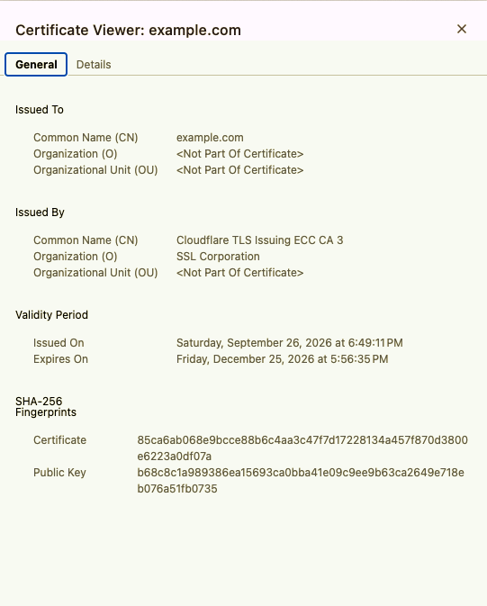
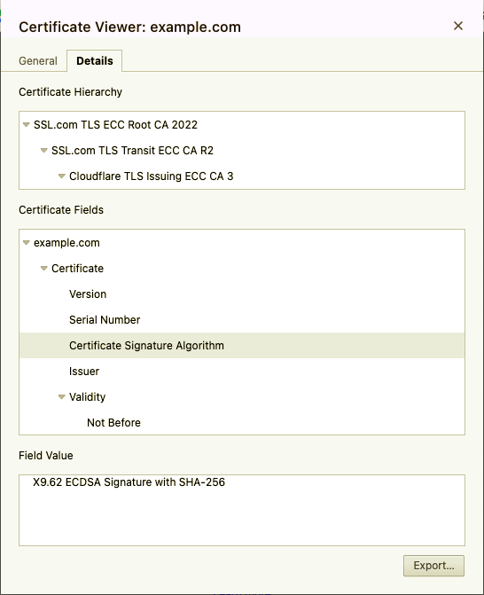

# Week 9 Lab 01 — Investigate a Certificate

**Student Name:** Siri Keyaka  
**Date Completed:** 09 November 2026  
**Module:** 3 — Practical Cryptography | **Week:** 9  

---

## Overview

In this lab, I inspected the TLS certificate for `example.com` using Google Chrome. I recorded the certificate's identity, validity dates, public-key information, permitted use, and issuing chain. I then compared the website hostname and observation date with the certificate fields and distinguished my own checks from the browser's reported connection status.

## Lab Environment

| Component | Details |
| --- | --- |
| Target | `https://example.com` |
| Environment | Google Chrome 150.0.7871.125 (Official Build, x86_64) on macOS 12 |
| Activity | Read-only TLS certificate inspection |
| Observation | November 9, 2026, approximately 1:03 PM EST (UTC−5) |
| Evidence | Certificate fields and certificate hierarchy screenshots |

---

## Part A — Initial Assessment and Connection Observation

### Step 1 — Predict First

No, checking the expiration date alone is not enough to determine whether a visitor should be trusted. The guard should also verify the visitor's identity, the issuing authority, and whether the badge permits access. Similarly, a browser checks a website certificate's hostname, validity dates, and trusted issuing authority before accepting the connection.

### Step 2 — Record Browser Observations

| Observation | Recorded result |
| --- | --- |
| Starting public URL | `https://example.com` |
| Final expected hostname | `example.com` |
| Observation date and time | November 9, 2026, approximately 1:03 PM |
| Time zone | Eastern Standard Time (EST, UTC−5) |
| Browser and version | Google Chrome 150.0.7871.125 (Official Build, x86_64) on macOS 12 |
| Browser connection status | Connection is secure |

---

## Part B — Certificate Inspection

### Step 1 — Record Leaf Certificate Fields

| Field | Observed value | Purpose |
| --- | --- | --- |
| Subject | `CN = example.com` | Identifies the certificate subject |
| Subject Alternative Name (SAN) | `DNS: example.com`; `DNS: *.example.com` | Lists the covered website names |
| Issuer | Cloudflare TLS Issuing ECC CA 3 | Identifies the issuing certificate authority |
| Not Before | September 26, 2026, 6:49:11 PM | Beginning of validity period |
| Not After | December 25, 2026, 5:56:35 PM | End of validity period |
| Subject public-key algorithm and size | Elliptic Curve Public Key; size not observed | Identifies the website public-key type |
| Certificate signature algorithm | X9.62 ECDSA Signature with SHA-256 | Identifies the issuer's signature method |
| Extended Key Usage (EKU) | TLS WWW Server Authentication | Authorizes server authentication |
| Basic Constraints | Critical; Is not a Certification Authority | Indicates this leaf certificate cannot issue other certificates |
| SHA-256 certificate fingerprint | `85ca6ab068e9bcce88b6c4aa3c47f7d17228134a457f870d3800e6223a0df07a` | Identifies this certificate |

### Step 2 — Verify Hostname and Validity Dates

**Expected hostname:** `example.com`  
**SAN entries observed:** `DNS Name: example.com` and `DNS Name: *.example.com`

The expected hostname, `example.com`, exactly matches a DNS name listed in the certificate's SAN extension. The wildcard `*.example.com` covers eligible subdomains, but the exact `example.com` entry is the match for the site I visited.

**Observation time:** November 9, 2026, approximately 1:03 PM EST (UTC−5). Chrome displayed the certificate validity dates and times, but the time zone used for those timestamps was not confirmed.

**Validity assessment:** The observation date falls after September 26, 2026, and before December 25, 2026. Based on the displayed dates, the certificate was within its validity period when I inspected it.

**Browser-reported result:** Google Chrome displayed "Connection is secure" and opened `example.com` without a certificate warning.

**Scope of my checks:** I compared the SAN entries against the expected hostname and the observation date against the certificate's validity dates. I did not independently validate every certificate signature or check revocation status.

---

## Part C — Certificate Chain Analysis

### Step 1 — Map the Observed Certificate Hierarchy

| Role | Subject | Issuer | Where observed | Limitation |
| --- | --- | --- | --- | --- |
| Leaf / website | example.com | Cloudflare TLS Issuing ECC CA 3 | Chrome Certificate Viewer | Whether the server sent the full chain was not independently captured |
| Intermediate | Cloudflare TLS Issuing ECC CA 3 | SSL.com TLS Transit ECC CA R2 | Chrome Certificate Viewer | Signature not independently verified |
| Additional intermediate | SSL.com TLS Transit ECC CA R2 | SSL.com TLS ECC Root CA 2022 | Chrome Certificate Viewer | Signature not independently verified |
| Root / trust anchor shown | SSL.com TLS ECC Root CA 2022 | Not independently verified | Chrome Certificate Viewer | Root issuer and trust status not independently verified |

### Step 2 — Explain the Chain of Trust

- **Website leaf signed by:** Cloudflare TLS Issuing ECC CA 3.
- **That issuer signed by:** SSL.com TLS Transit ECC CA R2.
- **Top authority displayed:** SSL.com TLS ECC Root CA 2022.

An issuing authority cannot establish trust simply by signing its own certificate. The browser must recognize and accept the root certificate as a trusted authority; otherwise, anyone could create a certificate and claim to be trustworthy. I inspected only Chrome's displayed hierarchy and did not independently capture the chain sent by the server.

---

## Part D — Evidence and Explanation

### Step 1 — Certificate Fields Screenshot

*Chrome certificate viewer showing certificate details for example.com, including its subject, issuer, validity period, and SHA-256 fingerprints.*

### Step 2 — Certificate Chain Screenshot

*Chrome certificate viewer showing the issuing certificate authorities and the displayed path to the SSL.com root CA.*

### Step 3 — Explain the Trust Relationship

The SAN list is like the name on a visitor's badge because it identifies which websites the certificate covers. The certificate for `example.com` was signed by Cloudflare TLS Issuing ECC CA 3. My browser relies on a chain leading to an accepted root authority, similar to a security guard recognizing an approved badge-issuing office. However, a valid certificate does not guarantee that everything on the website is safe or trustworthy.

---

## Analysis Questions

### Analysis Question 1 — Key Ownership and Signatures

**Why does a working key or correct signature not, by itself, prove that the key belongs to the support team?**

A working key or valid signature proves that the matching cryptographic key was used, but it does not automatically establish who owns that key. Someone could create their own key pair and label it as belonging to the support team. To establish trust, the key must be connected to the correct identity through a certificate issued by an authority the verifier trusts.

### Analysis Question 2 — Trusted Issuers

**Why must the browser check more than the printed issuer name?**

Anyone can put the name of a certificate authority on a certificate, so the printed issuer name alone is not proof of trust. The browser must validate the certificate signatures and follow the chain to a trusted root authority. The browser's trusted certificate store determines which root authorities it accepts, helping prevent unknown or unauthorized issuers from being trusted automatically.

### Analysis Question 3 — Connection Security and Limitations

**What did the name, date, and browser checks establish, and what did they not establish?**

I confirmed that `example.com` matched the certificate's SAN list and that my observation date fell within the certificate's validity period. Chrome loaded the website without displaying a certificate warning, although I did not independently verify every signature or check certificate revocation. These checks help establish that the certificate is appropriate for the connection, but they do not guarantee that the website's content, advice, or downloads are safe.

---

## Conclusion

This investigation demonstrated how a browser uses certificate identity, validity periods, and a chain of issuing authorities to assess an HTTPS connection. My manual inspection confirmed the hostname match and date range, while Chrome reported a secure connection. I also distinguished the browser's certificate validation from checks I did not independently perform and recognized that certificate validity does not guarantee trustworthy website content.

---

*CyberVisionaries Institute · Cyber Foundations · Tier I*
